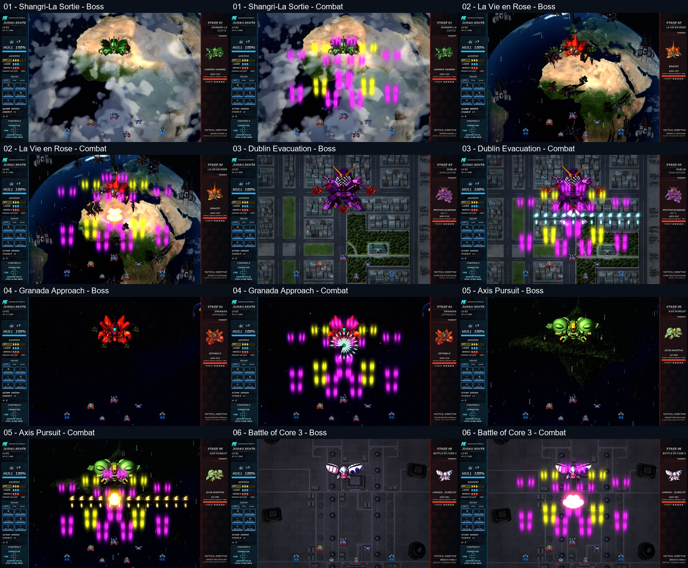
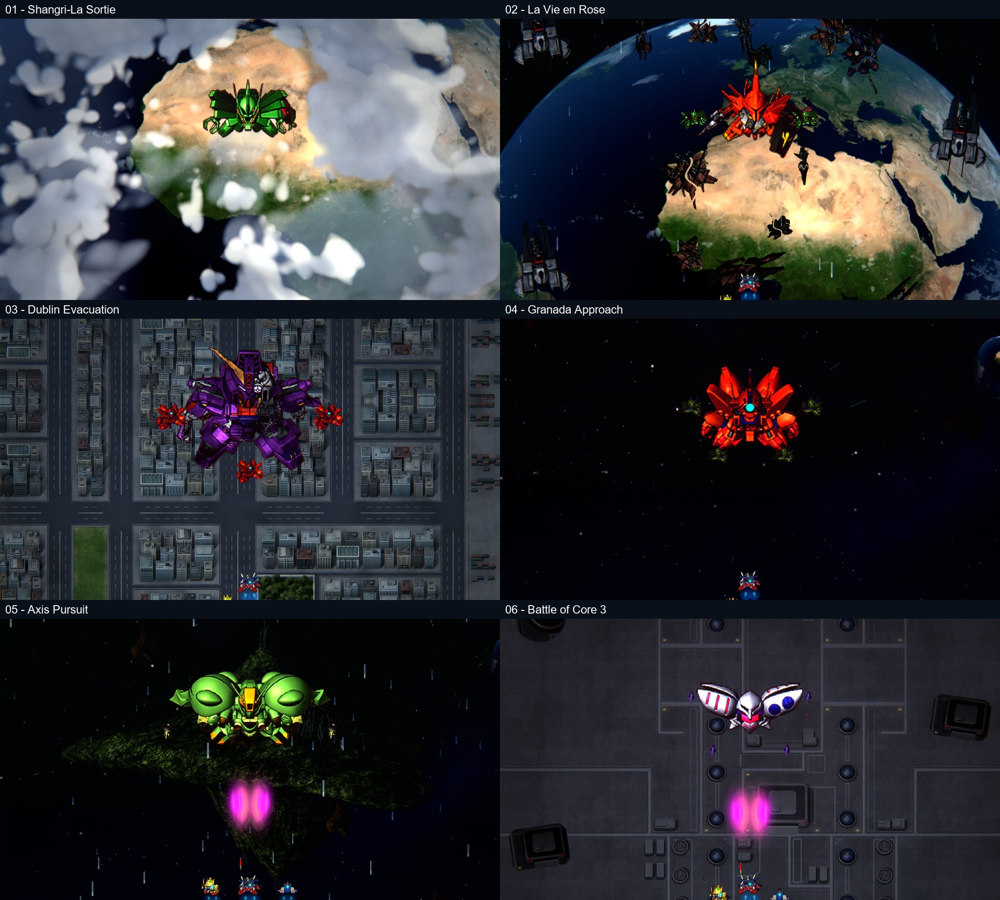

# Gundam Team STG

A free, unofficial Gundam ZZ fan mod for owners of **Razor Squadron** on Windows.

**[Download the latest Windows mod](https://github.com/adamblue83/gundam-team/releases/latest)**

## Install and play

1. Download **Gundam-Team-Windows-Mod-2026.11.01.zip** from Releases.
2. Extract the entire ZIP into a folder.
3. Open **Gundam Team Setup.exe** inside the extracted folder.
4. Select your full game's **RazorSquadron.exe**, then choose **Install / Update**.
5. Choose **Play**, or use the Gundam Team desktop shortcut.

No Godot installation or editor setup is required. Keep `payload` and `manifest.json` beside Setup.

## Requirements and supported versions

- Windows 10 or 11, 64-bit; allow about 2 GB of free space for installation and updates.
- Full Razor Squadron: **Steam October 24 settings build** or **Epic October 26 achievement-fix build**.
- Exact supported executable hashes are listed in [manifest.json](manifest.json). The installer checks your game automatically; demos and other revisions are not supported by this release.

The package contains patch data, not a complete playable game. The installer builds a separate mod copy from your supported original game and leaves the original installation untouched.

## Features

- ZZ Gundam and six additional selectable pilots/craft, with matching wingman and rescue identities.
- Six themed stages with ZZ enemies, animated bosses, scenery, and stage previews.
- Anaheim Electronics branding, a CRT-style video title screen, Gundam sound effects, and custom music.
- Separate mod progress, plus an installer and launcher with update and removal controls.

## Update or remove

Close the game, extract the newest release, and run its Setup to update. To remove the installed game files, choose **Remove mod** in the launcher. Your original game and saved progress are kept.

Default mod folder: `%USERPROFILE%\Games\Gundam Team`  
Mod saves: `%APPDATA%\Gundam Team`

The launcher verifies the supported original game before playing. If you move or update Razor Squadron, reinstall the mod against a supported build.

## Release status and support

This is the initial **release candidate**. Local installation, update, removal, integrity checks and startup were tested against both supported builds. The six stages received targeted development checks; this is not a full campaign or separate clean-PC certification.

If something goes wrong, [open an issue](https://github.com/adamblue83/gundam-team/issues) with your Windows version, game edition, and the error text. Please do not upload your original game executable or personal save files.

## Credits

Razor Squadron is created by Adam Blue / BlueGamer Productions. This is an unofficial fan project, not an official Gundam release or endorsement.

Gundam sprites and other media remain the property of their respective owners. Known source links and uploader credits are in [Asset Credits.txt](Asset%20Credits.txt). Third-party redistribution permissions have not been independently verified. The package does not grant rights to reuse those assets.

This repository hosts the release page and documentation; it does not publish Razor Squadron's source code.
